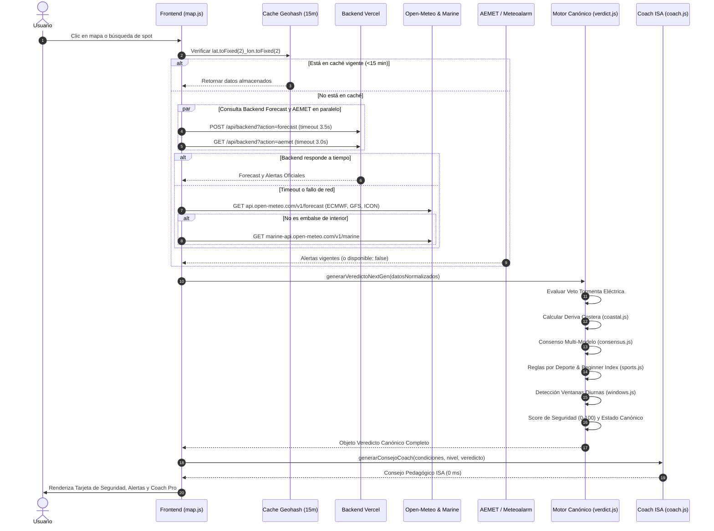

# AUDITORÍA TÉCNICA Y ARQUITECTÓNICA COMPLETA DE PADDLESAFE
**Fecha del Informe:** 15 de Octubre de 2026  
**Proyecto:** PaddleSafe — Asistente Experto de Seguridad para Deportes Acuáticos (Paddle Surf, Kayak, Surf, Wing Foil)  
**Objetivo del Documento:** Radiografía técnica exhaustiva del estado actual de la plataforma, identificando flujos de datos, dependencias, motores de cálculo, integración de IA, gestión de alertas y factores de experiencia de usuario (UX) que generan desconfianza, para fundamentar las decisiones de evolución futura sin modificar código de forma precipitada.

---

## 1. ARQUITECTURA ACTUAL

PaddleSafe opera bajo una arquitectura desacoplada híbrida optimizada para alta disponibilidad, resiliencia ante caídas de proveedores externos y funcionamiento en tiempo real:

```
┌────────────────────────────────────────────────────────────────────────┐
│                        CLIENTE PWA (HOSTINGER)                         │
│  public_html/ (HTML5, Tailwind CSS, Leaflet.js, Supabase JS v2, SW v8) │
│                                                                        │
│  ┌───────────────────────┐  ┌───────────────────────────────────────┐  │
│  │   UI & Interacción    │  │       Motor Experto Canónico          │  │
│  │  - Mapa interactivo   │  │  - verdict.js (Veredicto 5 estados)   │  │
│  │  - Tarjeta Básica     │  │  - coastal.js (Geodesia y Deriva)     │  │
│  │  - Modal Coach Pro    │  │  - sports.js (Reglas multideporte)    │  │
│  │  - GPS Tracker & GPX  │  │  - windows.js (Ventanas diurnas)      │  │
│  │  - Comunidad & Clubes │  │  - consensus.js (ECMWF, GFS, ICON)    │  │
│  └───────────┬───────────┘  └───────────────────▲───────────────────┘  │
│              │                                  │                      │
│              ▼                                  │                      │
│   ┌─────────────────────┐                       │                      │
│   │  Caché Geohash/Grid │                       │                      │
│   │ (~1.5 km, 15m TTL)  ├───────────────────────┘                      │
│   └──────────┬──────────┘                                              │
└──────────────┼─────────────────────────────────────────────────────────┘
               │
        ┌──────┴───────────────────────────────────────┐
        │                                              │
        ▼ (Petición HTTP Paralela)                     ▼ (Fallback / Consulta Directa)
┌───────────────────────────────┐              ┌─────────────────────────────────┐
│     BACKEND SERVERLESS        │              │     APIs EXTERNAS DIRECTAS      │
│     (VERCEL NODE.JS ESM)      │              │                                 │
│                               │              │  • api.open-meteo.com           │
│ • api/backend.js              │              │    - Best-Match, ECMWF, GFS,    │
│ • lib/handlers/aemet.js       │              │      ICON (10m wind, rachas,    │
│   (AEMET OpenData / ATOM)     │              │      clima, lluvia, presión)    │
│ • lib/handlers/coach.js       │              │  • marine-api.open-meteo.com    │
│   (Google Gemini 1.5 Flash)   │              │    - Altura ola, periodo, swell,│
│ • lib/handlers/route_coach.js │              │      temp agua, corrientes      │
│ • forecast.js                 │              │  • geocoding-api.open-meteo.com │
│   (Legacy Stormglass/Fallback)│              │                                 │
└──────────────┬────────────────┘              └─────────────────────────────────┘
               │
               ▼
┌───────────────────────────────┐
│     BASE DE DATOS SUPABASE    │
│  PostgreSQL 15 + PostGIS + RLS│
│  - Perfiles, Clubes, Rutas    │
│  - Gamificación, XP, Triggers │
│  - Auth & Storage (GPX/Fotos) │
└───────────────────────────────┘
```

### Componentes de Despliegue:
1. **Frontend PWA (Hostinger / Apache)**:
   - Directorio raíz servible: `public_html/`.
   - Control de versiones y cachés OTA a través de `public_html/version.json` (actualmente `v5.43`) y Service Worker `public_html/sw.js` (caché `paddlesafe-v45`).
   - Política estricta: Los datos meteorológicos y de seguridad **nunca** se almacenan en caché HTTP estática del Service Worker para evitar presentar información desactualizada como si fuera actual.
2. **Backend Serverless (Vercel / Node.js 20 ESM)**:
   - Enrutador unificado: `api/backend.js`.
   - Gestores específicos en `lib/handlers/` (`aemet.js`, `coach.js`, `route_coach.js`, `dashboard.js`, `conditions.js`, `safety.js`).
3. **Persistencia y Backend-as-a-Service (Supabase)**:
   - Autenticación, PostgreSQL con Row Level Security (RLS), base de datos geoespacial y WebSockets para chat de clubes en tiempo real.

---

## 2. FLUJO DE DATOS DETALLADO

El ciclo de vida de una consulta meteorológica y evaluación experta transcurre a través de los siguientes pasos cronológicos:



---

## 3. METEOROLOGÍA: FUENTES, INTEGRACIONES Y REDUNDANCIAS

### 3.1. Fuentes Utilizadas Actualmente
1. **Open-Meteo Forecast API (`api.open-meteo.com/v1/forecast`)**:
   - **Variables consultadas**: `wind_speed_10m`, `wind_gusts_10m`, `wind_direction_10m`, `temperature_2m`, `weather_code`, `precipitation`, `precipitation_probability`, `cloud_cover`, `relative_humidity_2m`, `surface_pressure`, `visibility`.
   - **Modelos solicitados simultáneamente**: `best_match`, `ecmwf_ifs025`, `gfs_seamless`, `icon_seamless`.
   - **Unidad de viento**: `ms` (convertido internamente a nudos `kt` y `km/h`).
2. **Open-Meteo Marine API (`marine-api.open-meteo.com/v1/marine`)**:
   - **Variables consultadas**: `wave_height`, `wave_period`, `wave_direction`, `swell_wave_height`, `swell_wave_period`, `swell_wave_direction`, `sea_surface_temperature`, `ocean_current_velocity`.
3. **AEMET / Meteoalarm (`lib/handlers/aemet.js`)**:
   - Ingestor georreferenciado por provincias y sectores costeros de España.
   - Fuente primaria: AEMET OpenData API (`opendata.aemet.es`) mediante clave de acceso.
   - Fuente secundaria abierta (sin API Key): Feed legacy ATOM de Meteoalarm España (`feeds.meteoalarm.org/feeds/meteoalarm-legacy-atom-spain`).
4. **Open-Meteo Elevation API (`api.open-meteo.com/v1/elevation`)**:
   - Utilizado en `map.js` para detectar si el usuario hace clic en tierra firme (>8 m de elevación relativa respecto al nivel del mar).
5. **Open-Meteo Geocoding API (`geocoding-api.open-meteo.com/v1/search`)**:
   - Resolución nominal de spots (playas, embalses, puertos).
6. **Stormglass API (`api.stormglass.io/v2/weather/point`) [LEGACY REDUNDANTE]**:
   - Presente en el backend histórico (`forecast.js`, `lib/handlers/conditions.js`, `lib/handlers/safety.js`).
   - Limitación grave: Plan gratuito limitado a 10 peticiones diarias. Provoca respuestas `HTTP 429` constantes si el frontend depende de él.
7. **OpenCage Geocoding API (`api.opencagedata.com`) [LEGACY REDUNDANTE]**:
   - Presente en `forecast.js` y `lib/handlers/conditions.js`. Requiere `OPENCAGE_KEY` y añade latencia innecesaria (1.5 segundos).

### 3.2. Fuentes Redundantes y Conflictos Detectados
- **Dualidad Frontend / Backend en la obtención de pronósticos**:
  `solicitarPronostico` en `map.js` invoca al backend Vercel (`?action=forecast`), pero le impone un timeout de 3.5 segundos. Como el backend intenta consultar Stormglass y OpenCage antes de recurrir a Open-Meteo, habitualmente supera los 3.5 segundos en arranques en frío (cold start). Esto provoca que la llamada se aborte sistemáticamente y el frontend termine realizando la llamada directa a Open-Meteo en el cliente.
- **Llamadas duplicadas en `consultarPrevisionRuta`**:
  En `map.js` (línea 1325), existe una función adicional de trazado de ruta que realiza una petición separada a Open-Meteo utilizando nombres de parámetros obsoletos (`windspeed_10m` en lugar de `wind_speed_10m`), sin aprovechar la caché de cuadrícula de 15 minutos.

---

## 4. MOTOR EXPERTO: CÁLCULO DE SCORE, SEGURIDAD Y RECOMENDACIONES

El motor experto reside de forma canónica en [`public_html/js/engine/verdict.js`](file:///c:/Users/Usuario/Desktop/WEBS/PaddleSafe/public_html/js/engine/verdict.js) a través de la función `generarVeredictoNextGen`.

### 4.1. Regla Suprema: Veto Infranqueable por Tormenta Eléctrica
Si se detecta cualquiera de los siguientes indicadores:
- Código de clima Open-Meteo `weather_code` en `[95, 96, 99]` (tormenta moderada o severa con granizo).
- Alerta oficial de AEMET cuyo texto incluya *tormenta, aparato eléctrico, rayos, relámpagos o descargas*.
- Parámetro booleano `tormenta: true`.

**Resultado Inmediato:**
- `scoreSeguridad = 0`.
- `estado = 'Tormenta eléctrica'`.
- `recomendacion = 'NO RECOMENDADO'`.
- `respuestaDirecta = '⛔ NO SALIR AL AGUA'`.
- `confianzaAnalisis = 95%`.
- Se cancela cualquier cálculo permisivo. No se pondera nivel de usuario (el peligro de descarga eléctrica afecta por igual a principiantes y campeones del mundo).

### 4.2. Algoritmo Cuantitativo del Score de Seguridad (0 a 100)
Para condiciones sin tormenta eléctrica, el score parte de una base favorable (95 puntos) y aplica penalizaciones físicas directas:

1. **Viento sostenido (`vReal` en nudos)**:
   - $\ge 20\text{ kt}$: $-60$ puntos.
   - $\ge 15\text{ kt}$: $-40$ puntos.
   - $\ge 11\text{ kt}$: $-20$ puntos.
   - $\le 6\text{ kt}$ y mar en calma ($\le 0.3\text{ m}$): Base optimizada a $98$ puntos.
2. **Rachas de viento (`rReal - vReal`)**:
   - Diferencia racha - viento $\ge 8\text{ kt}$: $-15$ puntos (turbulencia severa).
   - Diferencia $\ge 5\text{ kt}$: $-8$ puntos.
3. **Oleaje significativo (`oReal` en metros)**:
   - $\ge 1.5\text{ m}$: $-35$ puntos.
   - $\ge 0.8\text{ m}$: $-20$ puntos.
   - $\ge 0.5\text{ m}$: $-10$ puntos.
4. **Componente de viento costero (Deriva)**:
   - Viento *Offshore* (sopla de tierra hacia mar abierto): $-15$ puntos.
5. **Avisos Oficiales AEMET**:
   - Aviso Amarillo: Puntuación máxima acotada a $70$.
   - Aviso Naranja: Puntuación máxima acotada a $45$.
   - Aviso Rojo: Puntuación máxima acotada a $20$.

### 4.3. Matriz de Estados Categóricos
El score numérico y los umbrales físicos determinan el veredicto final:

| Estado Final | Icono | Criterio de Activación | Mensaje Directo |
| :--- | :---: | :--- | :--- |
| **Favorable** | 🟢 | Score $\ge 75$, viento $< 10\text{ kt}$, ola $< 0.5\text{ m}$, sin viento offshore ni alertas. | Salida Recomendada |
| **Precaución** | 🟡 | Score $55\text{--}74$, o viento $10\text{--}14\text{ kt}$, ola $0.5\text{--}0.9\text{ m}$, offshore presente, o aviso amarillo. | Precaución |
| **Condiciones exigentes** | 🟠 | Score $30\text{--}54$, o viento $15\text{--}19\text{ kt}$, ola $1.0\text{--}1.7\text{ m}$, o principiante con $\ge 10\text{ kt}$. | Condiciones exigentes |
| **No recomendado** | 🔴 | Score $< 30$, o viento $\ge 20\text{ kt}$, ola $\ge 1.8\text{ m}$, o aviso AEMET naranja/rojo. | No recomendado |
| **Tormenta eléctrica** | ⛔ | Código de tormenta o aviso de aparato eléctrico activo. | No salir al agua |

---

## 5. COACH IA: GENERACIÓN DE CONSEJOS, PROMPTS Y LIMITACIONES

### 5.1. Arquitectura de Doble Capa
El Coach opera con una arquitectura de dos niveles:
1. **Capa Inmediata Determinista (Cliente - `coach.js`)**:
   - Se ejecuta en el navegador con **latencia 0 ms**.
   - Implementa las directrices de la **International Surfing Association (ISA)** y la **Federación Española de Surfing (FESurfing)**.
   - Convierte los datos meteorológicos en **decisiones tácticas** sin repetir números obvios que el usuario ya lee en la pantalla.
   - Desglosa:
     - *Dureza de la ruta y esfuerzo muscular* (Escala 1 a 10).
     - *Estrategia de viento, tramo exigente y pacing* (dosificación física).
     - *Análisis de la orografía de la zona* (abrigo, cabos, efecto Venturi, clapotis en acantilados).
     - *Técnica, postura y mecánica de remada* adaptada al nivel.
     - *Material obligatorio y de seguridad* (leash de espiral vs recto, sistema de liberación rápida en río/embalse, chaleco 50N).
     - *Regla de oro del marinero*.
2. **Capa Enriquecida en la Nube (Backend - `lib/handlers/coach.js`)**:
   - Invocación en segundo plano no bloqueante mediante Google Gemini 1.5 Flash (`gemini-1.5-flash`).
   - Prompt de sistema especializado como Entrenador Máster Internacional ISA.
   - Formato estricto `application/json` con temperatura baja ($0.25$) para evitar alucinaciones.

### 5.2. Fortalezas del Coach
- **Resiliencia absoluta**: Si la API de Google Gemini no tiene saldo, no tiene clave configurada, da timeout o el usuario no tiene conexión a internet, la interfaz **nunca falla ni se queda en blanco**; el motor determinista local entrega el informe pedagógico completo al instante.
- **Análisis de Splits en Rutas Deportivas (`route_coach.js`)**:
  Capacidad de analizar archivos GPX calculando telemetría real: ritmo kilómetro a kilómetro, detección matemática de pérdida de velocidad por fatiga muscular (*positive split*) o aceleración final (*negative split*).

### 5.3. Limitaciones Actuales y Oportunidades de Mejora
- **Falta de memoria temporal entre sesiones**:
  El Coach evalúa la salida actual de forma aislada. No compara con salidas previas del mismo usuario en ese spot (ej. *"Hoy hay 3 nudos más de viento que en tu salida del pasado jueves"*).
- **Timeouts del frontend hacia el Coach Backend**:
  En `map.js` líneas 2137 y 2660, las llamadas en segundo plano a `?action=coach` tienen un timeout de 2000–2500 ms. En conexiones móviles 4G lentas, la respuesta de Gemini suele tardar 3000 ms, descartándose la respuesta enriquecida con frecuencia.

---

## 6. DERIVA COSTERA: CÁLCULO, DATOS Y LIMITACIONES

### 6.1. Algoritmo Actual de Deriva
Implementado en [`public_html/js/engine/coastal.js`](file:///c:/Users/Usuario/Desktop/WEBS/PaddleSafe/public_html/js/engine/coastal.js):

1. **Determinación del Vector Normal a Mar Abierto (`seawardDeg`)**:
   - Paso 1: Detección nominal en catálogo de spots conocidos (`SPOTS_CONOCIDOS`).
   - Paso 2: Detección de palabras clave de aguas interiores (*embalse, pantano, lago, río, presa*).
   - Paso 3: Algoritmo geodésico universal (`estimarRumboCosteroGeodesico`), que divide la península ibérica y archipiélagos en 18 cuadrantes geográficos delimitados por coordenadas:
     - Costa Cantábrica / Norte: $0^\circ$ (Norte).
     - Rías Baixas: $260^\circ$ (Oeste-Suroeste).
     - Golfo de Cádiz: $220^\circ$ (Suroeste).
     - Costa del Sol: $175^\circ$ (Sur).
     - Costa de Levante / Costa Blanca: $90^\circ\text{--}120^\circ$ (Este / Sureste).
     - Baleares / Canarias: Modelos poligonales específicos.
2. **Cálculo de la Incidencia Angular**:
   - Dirección hacia donde sopla el viento: $\text{rumboHacia} = (\text{dirVientoDeg} + 180^\circ) \pmod{360^\circ}$.
   - Diferencia angular con mar abierto: $\Delta\theta = |\text{rumboHacia} - \text{seawardDeg}|$.
   - **Clasificación**:
     - $\Delta\theta \le 55^\circ \implies$ **Offshore (Terral)**: viento empuja mar adentro.
     - $\Delta\theta \ge 125^\circ \implies$ **Onshore**: viento empuja hacia la playa.
     - $55^\circ < \Delta\theta < 125^\circ \implies$ **Side-shore**: viento empuja en paralelo a la línea de costa.
3. **Índice Numérico de Deriva PaddleSafe (0 a 100)**:
   - Suma ponderada de viento base ($+15$ a $+60$), factor de ráfagas ($+8$ a $+15$), oleaje ($+10$ a $+20$) y penalización directiva ($+25$ si es offshore, $-15$ si es onshore, $+10$ si es side-shore).

### 6.2. Limitaciones del Modelo Actual
1. **Omisión de Corrientes Marinas en el Cálculo Cuantitativo**:
   Aunque Open-Meteo Marine devuelve `ocean_current_velocity`, la fórmula de deriva actual solo pondera viento y oleaje. En zonas de corrientes intensas (como el Estrecho de Gibraltar, bocas de rías gallegas o rías de marea en el Cantábrico), la corriente puede generar tanta o más deriva que el propio viento.
2. **Geometría Macroscópica vs Micro-Bahías**:
   La estimación geodésica asigna rumbos regionales macroscópicos. En una ensenada o cala cerrada orientada al norte dentro de una región que generalmente mira al este (por ejemplo, Cala de la Granadella en Jávea), el rumbo general puede diferir del rumbo local de la cala.
3. **Efecto de la Altura del Practicante**:
   No se calcula la superficie vélica del cuerpo del paddler (un palista de pie ofrece entre 3 y 4 veces más resistencia aerodinámica que uno sentado de rodillas sobre la tabla).

---

## 7. SISTEMA DE ALERTAS: CONSULTA, INTEGRACIÓN Y PESO EN EL ANÁLISIS

### 7.1. Consulta de Alertas
- **Ruta de consulta**: `GET /api/backend?action=aemet&lat=...&lon=...`
- **Mecanismo**: El backend consulta la API oficial de avisos meteorológicos de AEMET y el feed Meteoalarm para España.
- **Geofiltrado**: Comprueba si las coordenadas están en el rectángulo geográfico de España ($27.0^\circ \le \text{lat} \le 44.2^\circ$; $-18.5^\circ \le \text{lon} \le 4.8^\circ$). Si está fuera, responde de inmediato indicando que la zona no está cubierta por AEMET, **sin generar errores**.
- **Caché del Ingestor**: 15 minutos en memoria para respetar las cuotas gubernamentales y prevenir sobrecargas.

### 7.2. Llegada a la Interfaz de Usuario (UI)
- Se procesa en `solicitarPronostico` en paralelo con el pronóstico de viento y oleaje.
- Si hay alertas vigentes:
  - Se genera un distintivo de advertencia oficial en la tarjeta experta del mapa (`proExpertMessage`, `basicExpertMessage`).
  - Se incluye en el desglose de factores críticos del modal experto (`factoresCriticos`).
  - Se incorpora a las directrices de seguridad del Coach.

### 7.3. Afectación al Análisis y Resiliencia (Casos de Uso)
- **Caso A (AEMET responde sin alertas)**:
  Análisis normal. El motor experto considera la ausencia de avisos oficiales como un factor de confianza positiva ($+5\%$).
- **Caso B (AEMET no disponible / caída temporal / fuera de España)**:
  El motor **continúa evaluando con Open-Meteo y Marine API**. Reduce sutilmente la confianza del análisis ($-5\%$), pero **en ningún caso invalida el veredicto ni bloquea la aplicación**.
- **Caso C (Alerta Amarilla costera o de viento)**:
  El motor experto acota la puntuación máxima de seguridad a $70/100$ y activa el estado de *Precaución*, advirtiendo sobre las zonas expuestas.
- **Caso D (Alerta Naranja o Roja)**:
  El motor experto acota la puntuación a un máximo de $45$ (Naranja) o $20$ (Roja) y activa inmediatamente el estado de *No recomendado*.
- **Caso E (Alerta de Tormenta / Fenómenos Eléctricos)**:
  Veto Infranqueable inmediato ($score = 0$, estado *Tormenta eléctrica*).

---

## 8. UX: DETECCIÓN DE MENSAJES QUE GENERAN DESCONFIANZA

Se ha realizado un rastreo exhaustivo en todo el código fuente para localizar textos que comuniquen sensación de fallo, incompetencia o duda al usuario. A continuación se detallan los hallazgos con archivo y número de línea:

### 8.1. Mensajes Críticos de Desconfianza Localizados

| Archivo | Línea | Mensaje Actual | Por qué genera desconfianza | Propuesta de sustitución |
| :--- | :--- | :--- | :--- | :--- |
| `public_html/js/map.js` | 2519–2520 | `⚠️ Información meteorológica insuficiente.`<br>`Repite el análisis cuando haya mediciones completas de viento y mar.` | Se dispara si `score < 40` y la confianza calculada era baja. El usuario interpreta que la app está rota o no sirve para ese lugar. | `Recomendación preventiva: Condiciones desaconsejadas para la navegación por alta variabilidad meteorológica.` |
| `public_html/js/map.js` | 2565 | `⚠️ Información meteorológica insuficiente para evaluar la seguridad.` | Bloquea la visualización del Coach Básico en lugar de dar un consejo conservador de seguridad en tierra. | `Por seguridad náutica, se recomienda permanecer en tierra firme ante la falta de estabilidad en los modelos.` |
| `public_html/js/map.js` | 390–391 | `No se pueden generar consejos personalizados sin datos meteorológicos fiables.`<br>`Consulta el parte marítimo oficial antes de salir...` | Hace dudar de la utilidad del sistema frente a otras fuentes tradicionales. | `Prioridad de seguridad: No se aconseja la entrada al agua mientras las condiciones en la zona no se estabilicen.` |
| `public_html/js/map.js` | 1168 | `No se pudo cargar el pronóstico... El coach no puede generar consejos personalizados sin datos fiables.` | Frase redundante mostrada tras error de red. | `No ha sido posible conectar con la red meteorológica. Comprueba tu conexión a internet.` |
| `public_html/js/utils.js` | 135 | `Las fuentes consultadas no disponen actualmente de información suficiente o suficientemente detallada para realizar una evaluación fiable de la seguridad.\n\nSe recomienda repetir el análisis más adelante...` | Texto residual histórico asignado a la constante `MENSAJE_DATOS_INSUFICIENTES`. | Eliminar esta constante y su uso residual. El motor canónico siempre debe emitir un veredicto seguro y accionable. |
| `public_html/js/utils.js`<br>`public_html/js/engine/verdict.js` | 82, 97<br>57, 71 | Clave `'ANÁLISIS INCOMPLETO'` en `CLASES_RIESGO` e `ICONOS_SEGURIDAD`. | Categoría legacy que sugiere que la plataforma es incapaz de completar el análisis. | La matriz de 5 estados canónicos (`Favorable`, `Precaución`, `Condiciones exigentes`, `No recomendado`, `Tormenta eléctrica`) cubre el 100% de los casos. La categoría `ANÁLISIS INCOMPLETO` debe eliminarse definitivamente. |
| `public_html/js/engine/sports.js` | 148 | `estado: 'Condiciones insuficientes'` (en Wing Foil por viento $< 11\text{ kt}$). | En deportes náuticos "insuficiente" suena a error del sistema, cuando en realidad se refiere a que hay calma chicha y no hay suficiente viento para elevar el foil. | `estado: 'Viento en calma para Foil'` (explicando: *"Viento suave para planear con foil; ideal para paseo o paddle surf recreativo"*). |

---

## 9. RIESGOS TÉCNICOS Y ARQUITECTÓNICOS

1. **Riesgo de Duplicidad y Divergencia entre Ramas de Git**:
   - La rama `main` alberga el backend de Vercel y los archivos SQL de Supabase.
   - La rama `frontend-deploy` (y `FrontEnd`) alberga el frontend estático de Hostinger (`public_html/`).
   - *Riesgo*: Si se introduce un cambio en la firma de datos del frontend sin actualizar el backend correspondiente (o viceversa), pueden producirse incompatibilidades silenciosas.
2. **Riesgo de Bloqueo por Servicios de Terceros Obsoletos (Stormglass/OpenCage)**:
   - Mantener llamadas a Stormglass en handlers de backend legacy (`conditions.js`, `safety.js`) es una bomba de relojería debido al límite de 10 peticiones/día de su capa gratuita. Si algún flujo secundario invoca estos endpoints, el usuario recibe errores `429 Too Many Requests`.
3. **Riesgo de Regresión por Caché del Navegador en Móviles**:
   - Las PWAs instaladas en dispositivos móviles son muy agresivas conservando Service Workers antiguos en memoria.
   - Es imperativo mantener sincronizados `version.json` y `sw.js` en cada despliegue para purgar cachés locales de scripts antiguos.

---

## 10. FUNCIONALIDADES QUE DEBEN CONSERVARSE

1. **Veto Infranqueable por Tormenta Eléctrica**:
   - Debe preservarse en la cima de la jerarquía de evaluación. La seguridad vital no es negociable ni reducible por nivel técnico.
2. **Arquitectura Canónica del Motor Experto (`verdict.js`)**:
   - La estructura de veredicto unificado de 5 estados categóricos con puntuación continua (0-100) y justificación náutica profesional.
3. **Capa Determinista del Coach ISA (0 ms de latencia)**:
   - Garantiza que la aplicación responda de inmediato y funcione sin depender exclusivamente de cuotas o disponibilidad de Gemini Flash.
4. **Caché de Cuadrícula Geohash (15 min)**:
   - Reduce drásticamente la factura de red y la latencia al navegar entre pestañas o consultar spots cercanos.
5. **Detección Automática de Aguas Interiores (Embalses y Lagos)**:
   - Evita consultas inútiles a Marine API en aguas interiores de la península (como el Embalse de San Juan, Iznájar o Entrepeñas), ahorrando cientos de milisegundos y eliminando errores 400.
6. **Vectorización Costera Geodésica y Clasificación de Deriva**:
   - Detección automática del viento offshore/onshore sin requerir configuración manual por parte del usuario.

---

## 11. FUNCIONALIDADES QUE DEBERÍAN REVISARSE O ELIMINARSE

1. **Eliminar los Handlers Backend Obsoletos de Stormglass**:
   - Reemplazar completamente el código de `forecast.js`, `lib/handlers/conditions.js` y `lib/handlers/safety.js` que hace referencia a Stormglass y OpenCage. Toda la ingesta meteorológica debe converger en Open-Meteo Multi-Modelo + Open-Meteo Marine.
2. **Integrar Corrientes Marinas en el Cálculo de Deriva**:
   - Aprovechar la variable `ocean_current_velocity` y `ocean_current_direction` de Marine API en `coastal.js`.
3. **Sustitución de Mensajes de Desconfianza**:
   - Erradicar la categoría `ANÁLISIS INCOMPLETO` y los textos de "información insuficiente" identificados en la sección 8 de esta auditoría, transformándolos en recomendaciones preventivas positivas.
4. **Unificación de Parámetros de Consulta de Viento en Trazado de Rutas**:
   - Corregir `consultarPrevisionRuta` en `map.js` (línea 1325) para usar `wind_speed_10m` y consumir la misma caché geohash.

---

## 12. RECOMENDACIONES PRIORIZADAS (ROADMAP DE ACTUACIÓN)

### Prioridad 1: Alta (Inmediata - Experiencia de Usuario y Robustez)
- **1.1. Limpieza de Textos de Desconfianza**:
  Sustituir en `map.js` y `utils.js` los avisos de "información insuficiente" y "análisis incompleto" por consejos preventivos de seguridad náutica ("Condiciones inestables: se aconseja prudencia en tierra").
- **1.2. Depuración de Handlers Backend Legacy**:
  Migrar `forecast.js` en el backend para que utilice exclusivamente Open-Meteo multi-modelo (ECMWF, GFS, ICON) y Marine API, eliminando dependencias de claves de Stormglass y OpenCage.

### Prioridad 2: Media (Precisión Náutica Avanzada)
- **2.1. Vectorización de Corrientes Marinas**:
  Incorporar el vector de corrientes oceánicas de Open-Meteo Marine en el algoritmo de `coastal.js`, sumando vectorialmente la fuerza de la corriente a la deriva aerodinámica.
- **2.2. Aumento de Timeout para Enriquecimiento del Coach IA**:
  Ampliar el timeout del frontend de 2.0s a 4.0s para llamadas no bloqueantes a Gemini Flash, permitiendo que las respuestas enriquecidas lleguen con éxito en conexiones móviles 3G/4G.

### Prioridad 3: Baja (Evolución y Gamificación)
- **3.1. Memoria Inter-Sesión del Coach**:
  Conectar el historial de rutas y sesiones del usuario en Supabase con el contexto del Coach para ofrecer comparativas históricas personalizadas.
- **3.2. Micro-Geometría de Spots Complejos**:
  Permitir a los clubes y administradores refinar el vector de salida a mar abierto de sus spots locales mediante una interfaz sencilla en el panel de club.

---

*Fin del informe de auditoría.*

