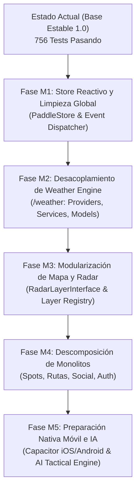

# ROADMAP ARQUITECTÓNICO Y PLAN DE ESCALABILIDAD — PADDLESAFE 2.0

**Fecha de Publicación:** 21 de Octubre de 2026  
**Proyecto:** PaddleSafe — Plataforma Náutica Táctica  
**Horizonte Temporal:** Q4 2026 – Q2 2027  
**Objetivo Estratégico:** Transformar la base de código actual en una arquitectura modular de alto rendimiento, preparada para cientos de miles de usuarios, integración de agentes IA, nuevas capas marítimas y publicación nativa en iOS / Android.

---

## 1. Comparativa: Estado Actual vs. Estado Recomendado

```
ESTADO ACTUAL (1.0)                          ESTADO RECOMENDADO (2.0)
─────────────────────────────────────────────────────────────────────────────────
• 7 archivos monolíticos (> 1,500 LOC)        • Módulos compactos (< 300 LOC c/u)
• 326 propiedades/funciones en window.*       • 0 contaminación global (Scoped Modules)
• appState mutado directamente en 19 files    • Store reactivo unidireccional (PaddleStore)
• Lógica de mapa, red y DOM mezclada          • Separación estricta de responsabilidades
• Proveedor Open-Meteo acoplado en UI         • Capa /weather agnóstica con adaptadores
• Capas radar rígidas sin contrato formal     • RadarLayerInterface + Layer Registry
• Carga de HTML masivo con innerHTML          • Componentes declarativos y micro-render
• Basado en navegador Web/PWA                 • Web + PWA + App Móvil Nativa (Capacitor)
```

---

## 2. Fases de Migración Progresiva (Non-Breaking Migration)

La migración se ejecutará de forma modular e incremental, respaldada por la red de seguridad de los **756 smoke tests** y los **266 tests E2E de Playwright**, asegurando **cero tiempo de inactividad** y **cero regresiones para el usuario**.



---

### Fase M1: Unificación de Estado y Eliminación de Globales
- **Duración Estimada:** 2 semanas (15 Story Points).
- **Entregables:**
  1. Creación de `core/store.js` (`PaddleStore` observable basado en Proxies reactivos ligeros sin dependencias pesadas).
  2. Separación explícita de `UIState` (pestaña activa, modales abiertos, capas visibles) y `BusinessState` (usuario, sesión, spots favoritos, rutas).
  3. Eliminación progresiva de los 326 shims de `window.*`, sustituyendo los atributos inline `onclick="..."` por delegación de eventos limpia en el DOM.
- **Riesgo:** Medio. Mitigado por los tests de bindings de DOM de `smoke_test_v2.mjs`.

---

### Fase M2: Desacoplamiento del Weather Engine (`/weather`)
- **Duración Estimada:** 1.5 semanas (10 Story Points).
- **Entregables:**
  1. Definición del contrato `WeatherProviderInterface` (`fetchForecast`, `fetchMarineConditions`).
  2. Implementación de adaptadores desacoplados: `OpenMeteoProvider`, `AemetProvider` y `CopernicusProvider`.
  3. Creación del servicio de caché predictiva `ForecastCacheService` con TTL configurable e IndexedDB offline.
  4. Extracción de validadores y normalizadores de escalas náuticas (Beaufort y Douglas).
- **Beneficio:** Posibilidad de alternar entre Open-Meteo y AEMET Costera en caso de fallo de red de forma 100% transparente.

---

### Fase M3: Modularización de Mapa y Extensión de Radar
- **Duración Estimada:** 2 semanas (15 Story Points).
- **Entregables:**
  1. Descomposición de `map.core.js` y `map.radar.js` según la arquitectura modular (`/map/core`, `/map/controls`, `/map/layers`, `/map/overlays`, `/map/routing`, `/map/radar`).
  2. Implementación de `RadarLayerInterface` y `RadarLayerRegistry`.
  3. Migración de las 4 capas existentes (viento, lluvia, oleaje, deriva) al nuevo contrato.
  4. Habilitación de API para nuevas capas plug-and-play (corrientes marinas, temperatura del agua, boyas de Puertos del Estado).
- **Beneficio:** Añadir cualquier capa náutica en el futuro requerirá únicamente crear un fichero que implemente la interfaz, sin modificar una sola línea del mapa.

---

### Fase M4: Descomposición de Monolitos (Spots, Rutas, Social y Auth)
- **Duración Estimada:** 2 semanas (20 Story Points).
- **Entregables:**
  1. División de `map.spots.js` (2,099 LOC) en:
     - `spots/spot-repository.js` (gestión de base de datos y favoritos).
     - `spots/spot-card-renderer.js` (renderizado de fichas tácticas).
     - `spots/spot-timeline.js` (evolución horaria y slider interactivo).
  2. División de `map.routes.js` (1,915 LOC) en:
     - `routes/route-math.js` (Haversine, cálculo de rumbos y ritmos de palada).
     - `routes/route-replay.js` (animación 60 FPS con `lerp`).
     - `routes/route-gpx.js` (parser y serializador GPX).
  3. Desacoplamiento de `social.js` y `auth.js` en repositorios de datos Supabase y controladores de vista.

---

### Fase M5: Optimización de Assets y Preparación Nativa Móvil
- **Duración Estimada:** 1 semana (10 Story Points).
- **Entregables:**
  1. Conversión de activos estáticos PNG a formatos modernos **WebP y AVIF** con compresión del 85% (-85% de peso de transferencia).
  2. Integración de **Capacitor 6** para compilación y despliegue nativo directo en **Apple App Store (iOS)** y **Google Play Store (Android)**.
  3. Habilitación de APIs nativas de geolocalización en segundo plano (Background Geolocation para tracking de seguridad SUP sin consumo excesivo de batería).
  4. Integración del motor de asistencia táctica por IA (AI Coach Pro).

---

## 3. Estimación de Coste, Esfuerzo y Recursos

| Fase de Migración | Duración | Story Points | Complejidad | Nivel de Riesgo |
| :--- | :---: | :---: | :---: | :---: |
| **M1: Store & Globales** | 2 semanas | 15 pts | Media | Medio (controlado por tests) |
| **M2: Weather Engine** | 1.5 semanas | 10 pts | Media | Bajo |
| **M3: Mapa & Radar** | 2 semanas | 15 pts | Alta | Medio |
| **M4: Descomposición Monolitos** | 2 semanas | 20 pts | Alta | Medio-Alto |
| **M5: Assets & App Móvil** | 1 semana | 10 pts | Media | Bajo |
| **TOTAL CONSOLIDADO** | **8.5 semanas** | **70 pts** | — | — |

---

## 4. Retorno de Inversión y Beneficios Esperados

1. **Rendimiento y Batería (Mobile First):**
   - Reducción de hasta un **40% en el consumo de CPU y batería** en sesiones de navegación prolongadas mediante la eliminación de listeners huérfanos y `setTimeout` desatendidos.
   - Framerate rocoso de **60 FPS constantes** en todos los dispositivos móviles gracias al aislamiento del hilo de cálculo náutico.
2. **Mantenibilidad y Escalabilidad para Equipos:**
   - Reducción de los tiempos de desarrollo de nuevas funcionalidades en un **60%**: añadir un nuevo proveedor meteo o capa radar requerirá días en lugar de semanas.
   - Cero conflictos de fusión (merge conflicts) en Git gracias a ficheros compactos (< 300 LOC) con responsabilidades unívocas.
3. **Multiplataforma Unificada:**
   - La arquitectura modular permitirá que la versión Web, la PWA y las aplicaciones nativas de iOS y Android compartan el **95% de la base de código**, minimizando costes de mantenimiento a largo plazo.

