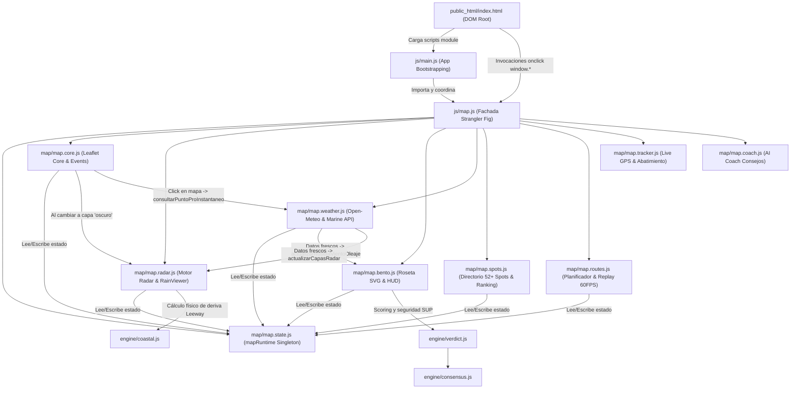
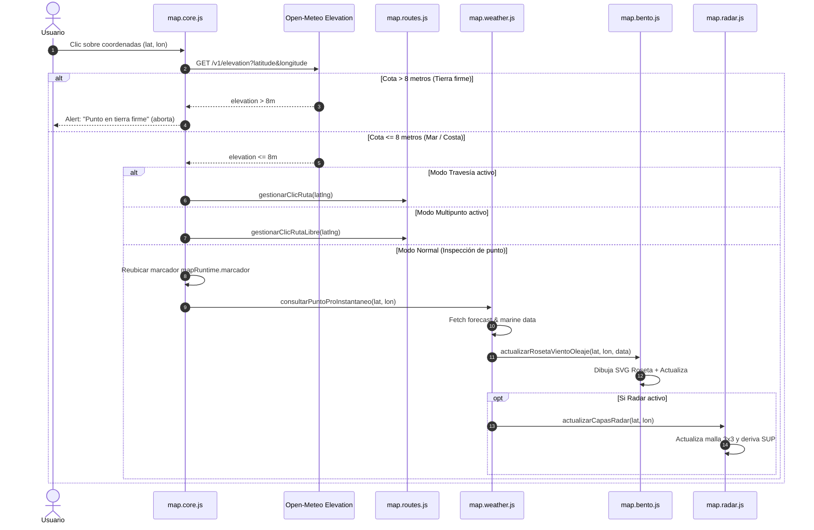

# MAPA DE DEPENDENCIAS Y FLUJOS LÓGICOS

> **Entregable:** PARTE 12 del Dossier Técnico de Auditoría de PaddleSafe  
> **Destinatario:** Argon (Arquitecto de Rediseño y Modelos Autónomos de IA)  
> **Fecha:** 21 de Octubre de 2026  
> **Área:** Flujo de Ejecución, Ciclo de Vida del Mapa Leaflet e Interacción entre Módulos  

---

## 1. Diagrama Lógico de Arquitectura y Llamadas

---

## 2. Matriz de Responsabilidades Críticas del Sistema

| Acción Crítica | Módulo Responsable | Función Principal | Archivo de Origen |
|---|---|---|---|
| **Inicia el mapa Leaflet** | `map.core.js` | `inicializarMapa()` | [`public_html/js/map/map.core.js`](file:///c:/Users/Usuario/Desktop/WEBS/PaddleSafe/public_html/js/map/map.core.js#L61) |
| **Controla y cambia capas base** | `map.core.js` | `cambiarCapaBaseMapa(estilo)` | [`public_html/js/map/map.core.js`](file:///c:/Users/Usuario/Desktop/WEBS/PaddleSafe/public_html/js/map/map.core.js#L576) |
| **Activa el Radar Táctico** | `map.radar.js` | `activarModoRadar()`, `toggleModoRadar()` | [`public_html/js/map/map.radar.js`](file:///c:/Users/Usuario/Desktop/WEBS/PaddleSafe/public_html/js/map/map.radar.js#L50) |
| **Dibuja la Roseta de Viento** | `map.bento.js` | `actualizarRosetaVientoOleaje(punto, meteo)` | [`public_html/js/map/map.bento.js`](file:///c:/Users/Usuario/Desktop/WEBS/PaddleSafe/public_html/js/map/map.bento.js#L1150) |
| **Consume APIs meteorológicas** | `map.weather.js` | `cargarPronosticoPunto(lat, lon, nombre)` | [`public_html/js/map/map.weather.js`](file:///c:/Users/Usuario/Desktop/WEBS/PaddleSafe/public_html/js/map/map.weather.js#L80) |
| **Renderiza paneles informativos** | `map.bento.js` + `map.routes.js` | `renderizarBentoDashboard()`, `renderizarDashboardPro()` | [`public_html/js/map/map.bento.js`](file:///c:/Users/Usuario/Desktop/WEBS/PaddleSafe/public_html/js/map/map.bento.js#L350) |
| **Gestiona eventos click en mapa** | `map.core.js` | `mapInstance.on('click', ...)` | [`public_html/js/map/map.core.js`](file:///c:/Users/Usuario/Desktop/WEBS/PaddleSafe/public_html/js/map/map.core.js#L313) |

---

## 3. Especificación Detallada de cada Flujo Operativo

### 3.1. ¿Qué módulo inicia el mapa?
* **Responsable:** [`public_html/js/map/map.core.js`](file:///c:/Users/Usuario/Desktop/WEBS/PaddleSafe/public_html/js/map/map.core.js) mediante `inicializarMapa()`.
* **Mecanismo:**
  1. Verifica que no exista una instancia previa en `mapRuntime.map`.
  2. Lee las coordenadas iniciales (`latitudActual || 38.80`, `longitudActual || 0.18`, correspondiente al Cabo de San Antonio, Dénia/Jávea).
  3. Ejecuta `L.map('mapaInteractivo').setView([lat, lon], 11)`.
  4. Asigna la instancia a `mapRuntime.map` y a `window.map`.
  5. Configura un `ResizeObserver` reactivo sobre `#mapContainer` y `#mapaInteractivo` con llamada a `requestAnimationFrame(() => map.invalidateSize())` para prevenir teselas grises tras transiciones CSS o redimensionamiento.
  6. Dispara la carga de la capa base inicial (`nautico`).

### 3.2. ¿Qué módulo controla las capas base?
* **Responsable:** [`public_html/js/map/map.core.js`](file:///c:/Users/Usuario/Desktop/WEBS/PaddleSafe/public_html/js/map/map.core.js) mediante `cambiarCapaBaseMapa(estilo)`.
* **Comportamiento según el parámetro `estilo`:**
  * `'nautico'` (por defecto):
    * Remueve capas base y overlays activos.
    * Agrega teselas de alta resolución CARTO Voyager HD: `https://{s}.basemaps.cartocdn.com/rastertiles/voyager/{z}/{x}/{y}{r}.png`.
    * Agrega la carta náutica de balizamiento marítimo OpenSeaMap: `https://tiles.openseamap.org/seamark/{z}/{x}/{y}.png`.
    * Desactiva el radar mediante `window.desactivarModoRadar()`.
  * `'satelite'`:
    * Agrega la capa de fotografía aérea Esri World Imagery: `https://server.arcgisonline.com/ArcGIS/rest/services/World_Imagery/MapServer/tile/{z}/{x}/{y}`.
    * Desactiva el radar mediante `window.desactivarModoRadar()`.
  * `'oscuro'` (Modo Radar):
    * Agrega la capa oscura de alto contraste CARTO Dark Matter: `https://{s}.basemaps.cartocdn.com/rastertiles/dark_all/{z}/{x}/{y}{r}.png`.
    * Invoca automáticamente `window.activarModoRadar()`.
  * **Sincronización UI:** Recorre todos los elementos `[data-map-layer]` del DOM (`#mapLayerSwitcher`) y les aplica la clase activa `.bg-sky-500/30.text-sky-300.border-sky-400`.

### 3.3. ¿Qué módulo activa el Radar?
* **Responsable:** [`public_html/js/map/map.radar.js`](file:///c:/Users/Usuario/Desktop/WEBS/PaddleSafe/public_html/js/map/map.radar.js) mediante `activarModoRadar()` o `toggleModoRadar()`.
* **Secuencia de inicialización del Radar:**
  1. Marca `mapRuntime.radarActivo = true`.
  2. Muestra el panel `#radarCockpitPanel` removiendo la clase `.hidden`.
  3. Crea o limpia los 4 `L.layerGroup` dedicados:
     * `radarWindGroup`: flechas y etiquetas de viento.
     * `radarWaveGroup`: vectores de dirección de ola y altura en metros.
     * `radarDriftGroup`: flechas violetas de abatimiento/deriva neta SUP.
     * `radarRainGroup`: capa de precipitaciones.
  4. Solicita a RainViewer (`api.rainviewer.com/public/weather-maps.json`) la lista de pasadas Doppler satelitales y superpone el `L.tileLayer` de lluvia animada.
  5. Obtiene el bounding box del mapa visible con `mapRuntime.map.getBounds()` y genera una cuadrícula táctica 3x3 de puntos de muestreo náutico.
  6. Para cada punto de la malla, interpola los datos de viento y olas y calcula la deriva SUP mediante `calcularDerivaCosteraPaddle()`.
  7. Evalúa las condiciones en el centro y emite el dictamen rápido de 10 segundos en el badge `#radarVerdictBadge` (`🟢 Excelente`, `🟡 Precaución`, `🔴 Peligroso`).

### 3.4. ¿Qué módulo dibuja la Roseta?
* **Responsable:** [`public_html/js/map/map.bento.js`](file:///c:/Users/Usuario/Desktop/WEBS/PaddleSafe/public_html/js/map/map.bento.js) mediante `actualizarRosetaVientoOleaje(punto, datosMeteo)`.
* **Mecanismo:**
  1. Si existía un marcador previo `mapRuntime.marcadorRosaVectores`, lo destruye del mapa con `currentMap.removeLayer()`.
  2. Genera un SVG de 120x120px que incluye:
     * Círculo central translúcido con los 4 puntos cardinales (N, S, E, W).
     * Flecha de viento rotada exactamente según `wind_direction_10m`.
     * Flecha de oleaje (cian) rotada según `wave_direction`.
     * Píldoras numéricas con la velocidad en nudos y la altura de la ola en metros.
  3. Lo envuelve en un `L.divIcon({ className: 'rosa-vectores-container', iconSize: [120, 120], iconAnchor: [60, 60] })`.
  4. Crea `mapRuntime.marcadorRosaVectores = L.marker([lat, lon], { icon: iconRosa, interactive: false, zIndexOffset: 250 }).addTo(currentMap)`.
  5. Llama a `actualizarHudVectoresMapa(lat, lon, datosMeteo)` para refrescar el cuadro inferior derecho `#mapWindWaveHud`.

### 3.5. ¿Qué módulo consume APIs meteorológicas?
* **Responsable:** [`public_html/js/map/map.weather.js`](file:///c:/Users/Usuario/Desktop/WEBS/PaddleSafe/public_html/js/map/map.weather.js) mediante `cargarPronosticoPunto(lat, lon, nombreSpot)`.
* **Endpoints consumidos:**
  * **Previsión Atmosférica:**  
    `https://api.open-meteo.com/v1/forecast?latitude={lat}&longitude={lon}&hourly=temperature_2m,relative_humidity_2m,apparent_temperature,precipitation_probability,precipitation,weather_code,surface_pressure,wind_speed_10m,wind_direction_10m,wind_gusts_10m,uv_index&daily=weather_code,temperature_2m_max,temperature_2m_min,sunrise,sunset,uv_index_max&timezone=auto`
  * **Previsión Marina:**  
    `https://marine-api.open-meteo.com/v1/marine?latitude={lat}&longitude={lon}&hourly=wave_height,wave_direction,wave_period,wind_wave_height,wind_wave_direction,wind_wave_period,swell_wave_height,swell_wave_direction,swell_wave_period&timezone=auto`
  * **Validación de Cota Terrestre:**  
    `https://api.open-meteo.com/v1/elevation?latitude={lat}&longitude={lon}`
* **Estrategia de caché:**
  * Guarda las respuestas en memoria indexadas por clave de coordenadas redondeadas a 3 decimales (`${lat.toFixed(3)}_${lon.toFixed(3)}`) con TTL de 30 minutos.
  * Si la API retorna error 429 (rate-limit), recurre al último pronóstico disponible en caché sin bloquear la interfaz.

### 3.6. ¿Qué módulo renderiza paneles informativos?
* **Panel Bento (Meteorología del Spot):** [`public_html/js/map/map.bento.js`](file:///c:/Users/Usuario/Desktop/WEBS/PaddleSafe/public_html/js/map/map.bento.js)
  * Renderiza `#bentoContainer` con la tarjeta de valoración de seguridad (anillo SVG de puntuación 0-100), tarjeta de viento/rachas, tarjeta de oleaje/periodo, recomendaciones de traje térmico y previsión diurna hora a hora.
* **Panel Travesía Pro:** [`public_html/js/map/map.routes.js`](file:///c:/Users/Usuario/Desktop/WEBS/PaddleSafe/public_html/js/map/map.routes.js)
  * Renderiza `#proDashboardResumen` con el análisis tramo por tramo (resistencia a favor 🟢, lateral 🟡, en contra 🔴) y distancia acumulada.
* **Panel de Repetición (Replay HUD):** [`public_html/js/map/map.routes.js`](file:///c:/Users/Usuario/Desktop/WEBS/PaddleSafe/public_html/js/map/map.routes.js)
  * Renderiza `#routeReplayCockpit` con la barra de progreso scrubber, velocímetro en km/h y rumbo en grados.

### 3.7. ¿Qué módulo gestiona eventos click sobre el mapa?
* **Responsable:** [`public_html/js/map/map.core.js`](file:///c:/Users/Usuario/Desktop/WEBS/PaddleSafe/public_html/js/map/map.core.js#L313).
* **Flujo de despacho:**

