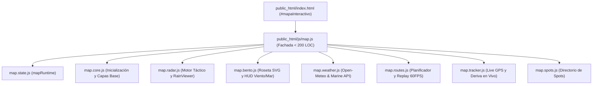
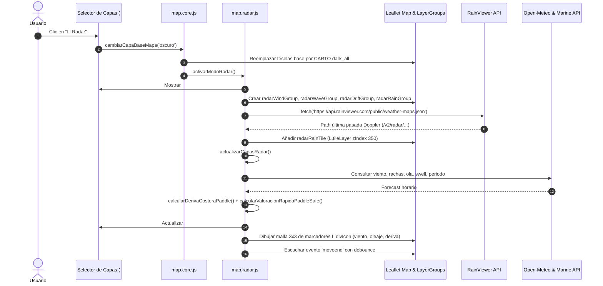
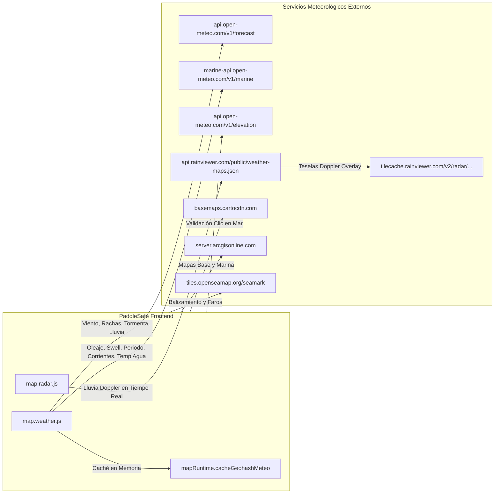

# DOSSIER TÉCNICO COMPLETO: ARQUITECTURA DEL MAPA Y SISTEMA RADAR DE PADDLESAFE

> **Documento:** `docs/radar-audit/RADAR_ARCHITECTURE_REPORT.md`  
> **Proyecto:** PaddleSafe — Plataforma Náutica Táctica y Pronóstico Marino para Stand Up Paddle (SUP)  
> **Fecha de Emisión:** 21 de Octubre de 2026  
> **Destinatario:** Arquitectos de Software, Ingenieros Frontend y Modelos de IA (Argon)  
> **Objetivo:** Radiografía exhaustiva, desacoplamiento y especificación del subsistema de mapas Leaflet, radar meteorológico y roseta de rumbos para rediseño sin regresiones.

---

## 1. REGISTRO DE CAPTURAS DEL SISTEMA

Se han generado 9 capturas de pantalla de alta fidelidad documentando todos los estados visuales y operativos del mapa, disponibles en el directorio `docs/radar-audit/screenshots/`:

| ID | Nombre de Archivo | Estado de la Interfaz | Resolución / Modo | Descripción Técnica |
|---|---|---|---|---|
| **01** | `01_mapa_normal.png` | Mapa Náutico Base | 1920x1080 (Desktop) | Teselas CARTO Voyager HD con capa de balizamiento marítimo OpenSeaMap (`seamark`). |
| **02** | `02_satelite.png` | Satélite Costero | 1920x1080 (Desktop) | Fotografía aérea de alta resolución proveída por Esri World Imagery. |
| **03** | `03_radar.png` | Radar Táctico Activo | 1920x1080 (Desktop) | Base oscura CARTO `dark_all`, Radar Cockpit flotante abierto, cuadrícula táctica 3x3 de vectores (viento, oleaje, deriva). |
| **04** | `04_radar_roseta.png` | Radar + Roseta Simultáneos | 1920x1080 (Desktop) | Superposición no conflictiva del Cockpit Radar y la Roseta táctica central SVG de 120x120px con `#mapWindWaveHud`. |
| **05** | `05_mapa_click_punto.png` | Inspección de Punto (Click) | 1920x1080 (Desktop) | Marcador Leaflet reubicado, validación de elevación costera y actualización de telemetría instantánea. |
| **06** | `06_panel_meteorologico.png` | Dashboard Meteorológico | 1920x1080 (Desktop) | Cuadrícula Bento completa con predicción horaria diurna, rachas, índice de seguridad y oleaje. |
| **07** | `07_movil_portrait.png` | Móvil Portrait | 390x844 (iPhone 14) | Cockpit responsive adaptado al ancho de pantalla, dock de navegación inferior y controles colapsados. |
| **08** | `08_movil_landscape.png` | Móvil Landscape | 844x390 (iPhone 14) | Distribución apaisada con mapa en altura optimizada y capas flotantes reordenadas. |
| **09** | `09_escritorio.png` | Cabina Completa Escritorio | 1920x1080 (Desktop) | Visión global con barra superior omnibar, selector de equipo, cockpit y panel de herramientas. |

*(Las capturas se encuentran almacenadas físicamente en [`docs/radar-audit/screenshots/`](file:///c:/Users/Usuario/Desktop/WEBS/PaddleSafe/docs/radar-audit/screenshots)).*

---

## 2. ARQUITECTURA DEL MAPA (LEAFLET CORE)

PaddleSafe implementa el patrón **Strangler Fig** sobre Leaflet v1.9.4. El archivo principal `public_html/js/map.js` actúa exclusivamente como una **Fachada (Facade)** orquestadora estricta (193 líneas de código, budget < 200 LOC), delegando la ejecución en submódulos especializados dentro de `public_html/js/map/`.



### Detalle de Módulos y Responsabilidades

| Archivo | Función Principal | Responsabilidad |
|---|---|---|
| `public_html/js/map.js` | Re-exports & Global Bindings | Fachada pública para la SPA; exporta métodos a `window.*` y coordina los 9 submódulos. |
| `public_html/js/map/map.state.js` | `mapRuntime` | Almacén central de estado reactivo mutable. Evita problemas de reasignación de punteros ES modules. |
| `public_html/js/map/map.core.js` | `inicializarMapa()` | Creación de la instancia `L.map('mapaInteractivo')`, centrado inicial (`[38.80, 0.18]`, Dénia/Jávea), configuración de eventos y `ResizeObserver`. |
| `public_html/js/map/map.core.js` | `cambiarCapaBaseMapa(estilo)` | Gestión de capas base Leaflet (`nautico`, `satelite`, `oscuro`) y control de capas superpuestas. |
| `public_html/js/map/map.core.js` | `obtenerUbicacion()` | Interfaz con la Geolocation API del navegador y centrado reactivo con animación. |
| `public_html/js/map/map.core.js` | `calcularTilesBoundingBox()` | Cálculo geométrico de teselas para descarga de mapas offline vía Service Worker. |

### Inicialización Leaflet (`map.core.js`)
```javascript
export function inicializarMapa() {
    if (mapRuntime.map) return;
    const initialLat = mapRuntime.latitudActual || 38.80;
    const initialLon = mapRuntime.longitudActual || 0.18;

    const mapInstance = L.map('mapaInteractivo').setView([initialLat, initialLon], 11);
    mapRuntime.map = mapInstance;
    if (typeof window !== 'undefined') window.map = mapInstance;

    cambiarCapaBaseMapa(mapRuntime.tipoCapaBase || 'nautico');
    // ...
}
```

---

## 3. SUBSISTEMA RADAR MARÍTIMO AVANZADO

* **Archivo:** [`public_html/js/map/map.radar.js`](file:///c:/Users/Usuario/Desktop/WEBS/PaddleSafe/public_html/js/map/map.radar.js)
* **Tamaño:** 502 líneas (26.7 KB en disco).
* **Dependencias:** `mapRuntime` (desde `map.state.js`), `resolverOrientacionCostera`, `kmhANudos` (desde `../utils.js`).

### Funciones Exportadas
1. `activarModoRadar()`: Inicializa grupos de capas vectoriales, consulta RainViewer y vincula actualización por movimiento.
2. `desactivarModoRadar()`: Oculta el cockpit y limpia las capas Leaflet activas.
3. `toggleCapaRadar(nombreCapa, forzarEstado)`: Habilita/deshabilita individualmente viento, lluvia, oleaje o deriva.
4. `ajustarOpacidadRadar(nivelOpacidad)`: Aplica opacidad porcentual (50%, 75%, 100%) tanto a teselas Doppler como a vectores SVG.
5. `actualizarCapasRadar(forzarLat, forzarLon)`: Recalcula telemetría central, evalúa el veredicto en 10s y renderiza la cuadrícula táctica 3x3.
6. `calcularDerivaCosteraPaddle(vientoKt, vientoDirDeg, olaM, swellDirDeg, tipoTabla)`: Modelo físico de deriva SUP.
7. `calcularValoracionRapidaPaddleSafe(params)`: Clasificador de seguridad (🟢 Excelente, 🟡 Buena, 🟠 Precaución, 🔴 No recomendable).
8. `generarSvgFlechaViento`, `generarSvgFlechaOleaje`, `generarSvgFlechaDeriva`: Generadores de iconografía vectorial SVG dinámica.

### Flujo de Ejecución del Radar



---

## 4. SUBSISTEMA ROSETA DE VIENTO Y RUMBOS

* **Función:** `renderizarRosaVectoresMapa(lat, lon, datosMeteo)`
* **Archivo:** [`public_html/js/map/map.bento.js`](file:///c:/Users/Usuario/Desktop/WEBS/PaddleSafe/public_html/js/map/map.bento.js#L1138) (Líneas 1138 – 1231)
* **HUD Asociado:** `actualizarHudVectoresMapa(lat, lon, datosMeteo)` (Líneas 1233 – 1309)

### Responsabilidades y Funcionamiento
1. **Composición Gráfica SVG**: Renderiza un elemento SVG táctico de 120x120px centrado exactamente sobre las coordenadas del spot activo mediante un único `L.marker` con clase `rosa-vectores-container` y `zIndexOffset: 250`.
2. **Componentes Visuales Internos**:
   * **Círculo Cardinal con Ticks**: Radio de 48px y 28px con indicación del Norte (`N` en color cyan `#38bdf8`).
   * **Vector de Oleaje (`rotOla`)**: Línea discontinua cyan (`#06b6d4`, ancho 2.5px) con punta de flecha orientada hacia la dirección de avance de la masa de agua.
   * **Vector de Viento (`rotViento`)**: Flecha sólida animada (ancho 3.5px) orientada hacia donde *sopla* el viento (origen + 180°), coloreada según umbral de seguridad (Verde < 10 kt, Amarillo 10-15 kt, Rojo > 15 kt).
   * **Pastillas Centrales**: Textos numéricos directos de velocidad de viento (`💨 X.Xk`) y altura de ola (`🌊 X.Xm`).
3. **Consumo de Datos**: Recibe un objeto `datosMeteo` con `windSpeed`, `windDirection`, `windGusts`, `waveHeight`, `waveDirection`, `wavePeriod`.
4. **HUD Complementario (`#mapWindWaveHud`)**: Panel de cristal flotante en la esquina inferior derecha con nombre del spot, badge de orientación costera (Offshore / Onshore / Side), flecha giratoria y rachas entre paréntesis.

### Dictamen Crítico: ¿Dependencia o Independencia?

> [!IMPORTANT]
> **LA ROSETA Y EL RADAR SON SISTEMAS 100% INDEPENDIENTES.**
> - La Roseta se activa automáticamente siempre que el usuario selecciona o busca un spot, en **cualquiera de los modos de mapa** (`nautico`, `satelite` u `oscuro`). Su marcador se almacena en `mapRuntime.marcadorRosaVectores`.
> - El Radar gestiona sus propios 4 grupos de capas (`radarWindGroup`, `radarWaveGroup`, `radarDriftGroup`, `radarRainGroup`) y el tile layer Doppler de RainViewer.
> - **Ambos coexisten armónicamente en el mapa**: la Roseta permanece centrada en el spot de interés con alta precisión local, mientras que el Radar despliega la malla táctica zonal sobre toda la ventana del viewport.

---

## 5. INVENTARIO COMPLETO DE CAPAS DEL MAPA

| Nombre de la Capa | Identificador en Código | Proveedor / Origen | Tipo de Capa | Visibilidad Predeterminada | Dependencias |
|---|---|---|---|---|---|
| **Base Náutica** | `mapRuntime.capaBaseTile` | CARTO Voyager HD | `L.tileLayer` (Raster) | Visible por defecto (modo `nautico`) | `CARTO_API_KEY` |
| **Balizamiento Marino** | `mapRuntime.capaOverlayTile` | OpenSeaMap Seamark | `L.tileLayer` (PNG Transparente) | Visible en modo `nautico` | OpenSeaMap Tile Server |
| **Satélite Costero** | `mapRuntime.capaBaseTile` | Esri World Imagery | `L.tileLayer` (Raster Satelital) | Visible en modo `satelite` | ArcGIS Online Server |
| **Base Radar Oscura** | `mapRuntime.capaBaseTile` | CARTO Dark All | `L.tileLayer` (Raster Dark) | Visible en modo `oscuro` | `CARTO_API_KEY` |
| **Lluvia Doppler** | `mapRuntime.radarRainTile` | RainViewer Doppler API | `L.tileLayer` (Radar Overlay) | Visible en modo Radar | RainViewer Maps JSON |
| **Malla Viento Radar** | `mapRuntime.radarWindGroup` | PaddleSafe / Open-Meteo | `L.layerGroup` (SVG `L.divIcon`) | Visible en modo Radar | `radarCapasActivas.viento` |
| **Malla Oleaje Radar** | `mapRuntime.radarWaveGroup` | PaddleSafe / Open-Meteo | `L.layerGroup` (SVG `L.divIcon`) | Visible en modo Radar | `radarCapasActivas.oleaje` |
| **Malla Deriva Radar** | `mapRuntime.radarDriftGroup` | PaddleSafe Física SUP | `L.layerGroup` (SVG `L.divIcon`) | Visible en modo Radar | `radarCapasActivas.deriva` |
| **Roseta de Viento** | `mapRuntime.marcadorRosaVectores` | PaddleSafe Bento | `L.marker` (SVG `L.divIcon`) | Visible al consultar spot | Consulta meteorológica activa |
| **Marcador Spot Central**| `mapRuntime.marcador` | Leaflet Core | `L.marker` (Leaflet Icon) | Visible en modo reposo | Coordenadas activas |
| **Trazado de Ruta** | `mapRuntime.lineaRuta` / `lineasMultiPunto` | PaddleSafe Planificador | `L.polyline` (Coloreada por esfuerzo) | Visible en Trazado A-B / Multipunto | Clics en el mar |
| **Replay 60FPS Surfer** | `mapRuntime.replayMarker` | PaddleSafe Replay Engine | `L.marker` (`L.divIcon` 🏄) | Visible durante Replay Flyover | Travesía cargada |
| **Replay Glow Trail** | `mapRuntime.replayTrailPolyline`| PaddleSafe Replay Engine | `L.polyline` (Cyan `#38bdf8`) | Visible durante Replay Flyover | `requestAnimationFrame` lerp |
| **Track GPS en Vivo** | `mapRuntime.livePolyline` | Geolocation API | `L.polyline` (Verde Esmeralda) | Visible durante Live GPS | `navigator.geolocation` |

---

## 6. CONTROLES Y PANELES SUPERPUESTOS EN EL MAPA

Todos los controles flotantes están contenidos dentro del elemento `#mapContainer` (`position: relative; z-index: 0`):

```
┌────────────────────────────────────────────────────────────────────────┐
│  [+] Zoom Leaflet (top: 10px, left: 10px, z: 1000)                     │
│  [-]                                                                   │
│                                           [🗺️ Mapa | 🛰️ Sat | 📡 Radar] │
│                                             (#mapLayerSwitcher: top: 12px,│
│                                              right: 12px, z: 400)      │
│                                                                        │
│  ┌──────────────────────────────────┐                                  │
│  │ #radarCockpitPanel (z: 410)       │                                  │
│  │ Top: 105px, Left: 12px, W: 350px  │                                  │
│  │ [🟢 Excelente] [✕]                │                                  │
│  │ [💨] [🌧️] [🌊] [🧭]              │                                  │
│  │ Telemetría central / Deriva       │                                  │
│  │ Opacidad: 50% 75% 100%            │                                  │
│  └──────────────────────────────────┘                                  │
│                                                                        │
│                       🧭 Roseta SVG (z: 250)                           │
│                          (lat, lon spot)                               │
│                                                                        │
│                                             ┌────────────────────────┐ │
│                                             │ #mapWindWaveHud (z:400)│ │
│                                             │ Bottom: 24px, R: 16px  │ │
│                                             │ 💨 9.3 kt  🌊 0.5m     │ │
│                                             └────────────────────────┘ │
│  ┌──────────────────────────────────────────────────────────────────┐  │
│  │ #routeReplayHud / #multipuntoToolbar (bottom: 12px-24px, z: 450) │  │
│  └──────────────────────────────────────────────────────────────────┘  │
└────────────────────────────────────────────────────────────────────────┘
```

### Tabla de Posicionamiento y Z-Index

| Componente | Selector DOM | Posición CSS | Coordenadas Exactas | Z-Index | Responsabilidad |
|---|---|---|---|---|---|
| **Selector de Capas** | `#mapLayerSwitcher` | `absolute` | `top: 12px; right: 12px;` | `z-[400]` | Alterna entre `nautico`, `satelite` y `oscuro`. |
| **Radar Cockpit** | `#radarCockpitPanel` | `absolute` | `top: 105px; left: 12px; right: 12px;` (móvil)<br>`sm:left: 12px; sm:right: auto; sm:w: 350px;` | `z-[410]` | Selector de capas radar, inspector de telemetría y veredicto 10s. |
| **HUD Viento / Mar** | `#mapWindWaveHud` | `absolute` | `bottom: 24px; right: 12px; sm:right: 16px;` | `z-[400]` | Lectura numérica instantánea de viento, rachas, ola y orientación costera. |
| **Zoom Leaflet** | `.leaflet-control-zoom` | `absolute` | `top: 10px; left: 10px;` | `z-[1000]` | Zoom in / out nativo táctil de Leaflet. |
| **Leyenda de Ruta** | `#leyendaMapa` | `absolute` | `top: 80px; left: 12px; width: 140px;` | `z-[400]` | Semáforo de esfuerzo (A favor 🟢, Lateral 🟡, En contra 🔴). |
| **Barra Multipunto** | `#multipuntoToolbar` | `absolute` | `bottom: 24px; left: 50%; transform: -50%;` | `z-[400]` | Acciones de edición (Ida y Vuelta, Deshacer, Limpiar, GPX). |
| **Route Replay HUD** | `#routeReplayHud` | `absolute` | `bottom: 12px; inset-x: 8px; sm:inset-x: 24px;` | `z-[450]` | Reproductor de travesía a 60 FPS con scrubber y telemetría Strava-like. |
| **Live HUD Cockpit** | `#liveTrackingPanel` | `absolute` | `top: 12px; left: 12px; right: 12px;` | `z-[400]` | Cockpit de navegación activa GPS, rumbo de vuelta y botón SOS. |

---

## 7. MATRIZ DE EVENTOS DEL MAPA Y REACCIONES

| Evento Leaflet | Origen | Componentes que Reaccionan | Comportamiento y Efecto Secundario |
|---|---|---|---|
| `'click'` | Usuario pulsa el mapa | `map.core.js`<br>`map.routes.js`<br>`map.radar.js`<br>`map.bento.js` | 1. Valida elevación costera (`elevation <= 8m`).<br>2. Si modo travesía: añade punto a la ruta planificada.<br>3. Si modo radar: reubica el foco táctico (`actualizarCapasRadar`).<br>4. Modo normal: mueve marcador, consulta Open-Meteo y actualiza la Roseta y el HUD. |
| `'moveend'` | Usuario arrastra el mapa | `map.radar.js` | Si `mapRuntime.radarActivo === true`, recalcula los límites visibles (`bounds`) y regenera la cuadrícula 3x3 de vectores sin recargar el mapa completo. |
| `'zoomend'` | Usuario cambia el zoom | `L.tileLayer`<br>`map.radar.js` | Leaflet escala las capas de teselas. Las capas vectoriales del radar se reajustan a las nuevas coordenadas visuales. |
| `'resize'` | Cambio de tamaño ventana / rotación | `map.core.js` (`ResizeObserver`) | Ejecuta `mapRuntime.map.invalidateSize()` mediante `requestAnimationFrame` para evitar la aparición de teselas grises en cambios de orientación. |
| `'layerchange'` | Clic en `#mapLayerSwitcher` | `map.core.js`<br>`map.radar.js` | Invoca `cambiarCapaBaseMapa()`, desmonta capas base anteriores y activa o desactiva el modo radar y su cockpit flotante. |

---

## 8. INTEGRACIÓN DE DATOS METEOROLÓGICOS Y APIS



### Especificación de Endpoints Consumidos

1. **Atmosférico & Viento (Open-Meteo Forecast)**:
   * **URL:** `https://api.open-meteo.com/v1/forecast`
   * **Variables:** `wind_speed_10m`, `wind_gusts_10m`, `wind_direction_10m`, `temperature_2m`, `weather_code`, `precipitation`, `precipitation_probability`, `cloud_cover`, `relative_humidity_2m`, `surface_pressure`, `visibility`.
   * **Modelos Combinados:** `best_match`, `ecmwf_ifs025`, `gfs_seamless`, `icon_seamless`.
2. **Marino & Oleaje (Open-Meteo Marine)**:
   * **URL:** `https://marine-api.open-meteo.com/v1/marine`
   * **Variables:** `wave_height`, `wave_period`, `wave_direction`, `swell_wave_height`, `swell_wave_period`, `swell_wave_direction`, `sea_surface_temperature`, `ocean_current_velocity`.
3. **Radar Doppler & Satélite Lluvia (RainViewer)**:
   * **Metadatos:** `https://api.rainviewer.com/public/weather-maps.json`
   * **Teselas:** `https://tilecache.rainviewer.com/v2/radar/{timestamp}/256/{z}/{x}/{y}/2/1_1.png`
4. **Elevación Costera (Anti-Click en Tierra)**:
   * **URL:** `https://api.open-meteo.com/v1/elevation?latitude={lat}&longitude={lon}`

---

## 9. MATRIZ DE COMPORTAMIENTO RESPONSIVE

| Componente | Escritorio (≥ 1024px) | Tablet (768px – 1023px) | Móvil Portrait (< 768px) | Móvil Landscape (Alto < 500px) |
|---|---|---|---|---|
| **Navegación Superior** | Visible (`#desktopHeaderNav`) | Oculto | Oculto | Oculto |
| **Dock Inferior Móvil** | Oculto (`#mobileBottomNav`) | Visible (5 botones) | Visible con Safe-Area | Visible compacto |
| **Altura del Mapa** | `min-h-[640px]` | `min-h-[460px]` | `height: 60vh; min-h-[350px]` | `height: 80vh; min-h-[300px]` |
| **Panel Pro (`#panelPro`)** | Siempre abierto (`lg:!grid-rows-[1fr]`) | Desplegable con `#btnPro` | Desplegable con `#btnPro` | Desplegable |
| **Radar Cockpit** | Ancho fijo `350px` a la izquierda | Ancho fijo `340px` | Ancho fluido `left-3 right-3` | Compacto superior |
| **Selector de Capas** | Esquina sup. derecha | Esquina sup. derecha | Esquina sup. derecha | Esquina sup. derecha |
| **HUD Viento / Mar** | Esquina inf. derecha | Esquina inf. derecha | Flotante sobre base mapa | Esquina inf. derecha reducida |
| **Botones Operativos Mapa**| Fila horizontal envolvente | Cuadrícula fluida | 2 columnas (`grid-cols-2`) | Fila con scroll horizontal |

---

## 10. EVALUACIÓN TÉCNICA PARA ARGON (LIMITACIONES, RIESGOS Y RECOMENDACIONES)

### A. Limitaciones Actuales Identificadas
1. **Interpolación Espacial Sintética en Radar**: La cuadrícula 3x3 de vectores de viento y oleaje se calcula a partir de un punto central aplicando offsets analíticos. No interpola campos de viento GRIB2/NetCDF continuos ni mallas ráster UV reales.
2. **Ausencia de Reproductor Temporal RainViewer**: El radar carga únicamente el último fotograma Doppler estático. No cuenta con un scrubber de línea temporal para visualizar la animación pasada (últimas 2 horas) ni el *nowcast* a futuro.
3. **Múltiples Marcadores DOM Individuales**: La malla de vectores utiliza instancias `L.marker` con `L.divIcon`. Si bien con 9 puntos es altamente eficiente, aumentar la densidad a 50+ puntos provocaría sobrecarga en el DOM en dispositivos de gama media/baja.

### B. Riesgos Técnicos en un Rediseño
1. **Riesgo de Acoplamiento Roseta-Radar**: Unificar la Roseta con el Radar rompería la visualización de viento en el mapa náutico estándar y satélite. La Roseta **debe seguir siendo un componente autónomo**.
2. **Saturación Z-Index en Móvil**: La coexistencia de `#mapLayerSwitcher` (z:400), `#radarCockpitPanel` (z:410), `#mapWindWaveHud` (z:400), `#routeReplayHud` (z:450) y modales (`.ps-modal-backdrop` z:9999) requiere mantener la jerarquía de z-index estrictamente documentada para evitar solapamientos táctiles.
3. **Bloqueo por Rate Limiting**: Consultas simultáneas a RainViewer y Open-Meteo durante paneos rápidos pueden provocar bloqueos HTTP 429. Es mandatorio preservar el *debouncing* y la caché `cacheGeohashMeteo`.

### C. Recomendaciones Estratégicas para Argon / Arquitecto Externo
1. **Evolución a Canvas Vectorial (`L.canvasLayer`)**: Si se desea una visualización de partículas de viento fluidas (estilo *Windy* o *EarthNullSchool*), implementar un lienzo `<canvas>` unificado en lugar de marcadores individuales, manteniendo el cálculo físico de deriva (`calcularDerivaCosteraPaddle`).
2. **Reproductor de Línea Temporal Doppler**: Ampliar el Cockpit del Radar para consumir los arrays `rvData.radar.past` y `rvData.radar.nowcast`, permitiendo pausar, reproducir y deslizar la animación de tormentas con precarga de teselas en memoria.
3. **Preservación Estricta de la Fachada**: Cualquier adición al radar debe residir internamente en `public_html/js/map/map.radar.js` o en un nuevo submódulo (ej. `map.radar.player.js`). La fachada `public_html/js/map.js` **no debe superar las 200 líneas de código**.
4. **Mantenimiento del Modelo Físico SUP**: El cálculo de arrastre sobre francobordo según el tipo de tabla (`inflat_allround` 4.0%, `inflat_touring` 3.5%, `rigid_touring` 3.0%, `rigid_race` 2.5%) combinado con el arrastre de Stokes (`sM * 0.25 kt/m`) es una ventaja competitiva exclusiva de PaddleSafe y debe preservarse intacto.
5. **Alineación con Axe-Core y WCAG AA**: Cada nuevo botón, slider de opacidad o selector que se añada al Radar Cockpit debe incluir atributos `aria-label`, contraste accesible y dimensiones mínimas táctiles de 44x44px.

---

## 11. SUITE DE DOCUMENTACIÓN TÉCNICA ADICIONAL (ENTREGABLES COMPLEMENTARIOS)

Para un análisis exhaustivo y ejecución sin fricción por parte de Argon, este dossier se complementa con los siguientes documentos técnicos especializados:

1. 📂 **[Árbol de Archivos Relevante (Parte 11)](file:///c:/Users/Usuario/Desktop/WEBS/PaddleSafe/docs/radar-audit/FILE_TREE.md)** (`docs/radar-audit/FILE_TREE.md`):
   * Estructura jerárquica de ficheros de mapas, radar, roseta, meteorología y motores físicos.
   * Líneas de código, tamaño en KB, responsabilidades y dependencias directas e inversas.

2. 🔄 **[Mapa de Dependencias y Flujos Lógicos (Parte 12)](file:///c:/Users/Usuario/Desktop/WEBS/PaddleSafe/docs/radar-audit/DEPENDENCY_MAP.md)** (`docs/radar-audit/DEPENDENCY_MAP.md`):
   * Diagramas Mermaid de arranque, despacho de eventos `click`, cambio de capas y consumo de APIs de Open-Meteo y RainViewer.
   * Matriz de atribución de responsabilidades por módulo.

3. 🛡️ **[Elementos Críticos a Preservar e Inspección de Capas Visuales (Partes 13 y 14)](file:///c:/Users/Usuario/Desktop/WEBS/PaddleSafe/docs/radar-audit/CRITICAL_COMPONENTS.md)** (`docs/radar-audit/CRITICAL_COMPONENTS.md`):
   * Los 10 componentes intocables que no deben romperse durante la evolución del Radar.
   * Matriz exhaustiva de Z-Index, posiciones DOM, clases responsive y reglas de apilamiento visual.

---
*Dossier generado y validado contra el entorno de producción y suites automatizadas de PaddleSafe.*

